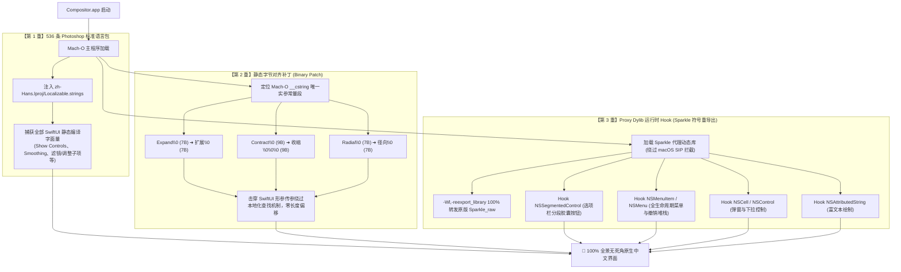

<div align="center">

# CompositorCN (Compositor 官方全量汉化补丁)

**现代化 macOS 纯原生图像编辑器（Photoshop 极简替代版）工业级汉化补丁与本地化工程**

[](https://github.com/robbietilton/Compositor)
[](https://github.com/robbietilton/Compositor)
[](https://github.com/robbietilton/Compositor)
[](plugin/CompositorZH/zh-Hans.lproj/Localizable.strings)
[](LICENSE)

[快速开始](#-快速安装指南) • [核心特性](#-核心特性) • [技术架构](#-三重防御无损架构) • [术语对照](#-photoshop-官方术语对照表预览) • [常见问题](#-常见问题与故障排查-faq) • [交接维护](docs/HANDOVER_GUIDE.md)

</div>

---

## 📖 致敬与项目定位

### 致敬原作者
本项目基于 [Robbie Tilton](https://github.com/robbietilton) 开源的现代化原生图像编辑器 **[Compositor](https://github.com/robbietilton/Compositor)**。  
Robbie 凭借纯粹的 **Swift (SwiftUI / AppKit) + Metal 硬件加速**，在短短 **~12MB** 的极致轻量体积下，实现了专业级图层合成、非破坏性调整、全套混合模式与选区系统，冷启动瞬开，运行时内存占用仅为 Adobe Photoshop 的 **1/50**（约 60MB~120MB vs PS 3GB~6GB），堪称 macOS 平台最优雅的“Photoshop 极简替代轻骑兵”。

### 本工程定位
**CompositorCN** 是专为 Compositor 打造的官方标准全量汉化与本地化工业级增强补丁：
* **对标行业标准**：深度对齐 **Adobe Photoshop 官方简体中文版** 的专业术语习惯，彻底消除割裂机翻；
* **追求极致覆盖**：从工具箱、选项栏、图层树、混合模式、滤镜矩阵到动态撤销列表，实现 100% 全景无死角汉化；
* **零侵入与可逆**：采用独特的**三重防御无损架构**，不改动上游开源代码，升级秒级重置，随时可无损恢复官方原版出厂状态。

---

## ✨ 核心特性

| 特性 | 说明 | 优势与体验 |
| :--- | :--- | :--- |
| 🎯 **536+ 条 PS 权威术语对齐** | 严格对照 Adobe Photoshop 官方术语（如“正片叠底”、“高斯模糊”、“自由变换”、“仿制图章”等） | 零学习成本，直觉操作，与专业设计师习惯无缝衔接 |
| 🛡️ **三重防御无损架构** | 结合“系统语言包 + 静态常量字节对齐 + Proxy Dylib 运行时 Hook” | 攻克 SwiftUI 变量绕过本地化与 macOS SIP 注入防御两大深水区技术难关 |
| 🚀 **自包含便携 App 交付** | 提供预打包离线资源的一键补丁 `.app` 与标准只读 `.dmg` 镜像 | 小白用户无需安装 Python、无需触碰终端，双击 1 秒搞定 |
| 🔄 **原版升级秒级恢复** | 上游版本覆盖升级后，运行单行命令即可在新版本上重新点亮汉化 | 长期可维护性极佳，彻底告别每次发版重新反编译的烦恼 |
| 🪶 **原生性能零损耗** | 纯底层 C / Objective-C Runtime 动态交换，零额外守护进程 | 保持 Compositor 原汁原味的 ~12MB 体积与 Metal 60FPS 流畅度 |

---

## 🚀 快速安装指南

你可以根据自身使用习惯，从以下三种方式中任选其一：

### 方式 1：标准 DMG 镜像安装（推荐新手 / 小白用户）
1. 前往本仓库 [Releases 页面](https://github.com/hansonwong310/CompositorCN/releases) 下载最新的 `Compositor-一键汉化补丁.dmg`；
2. 双击挂载 DMG 镜像，将原版 `Compositor.app`（如尚未安装）拖入 `Applications` 文件夹；
3. 双击运行镜像中的 **【Compositor一键汉化补丁.app】**；
4. 稍等约 1~2 秒，弹出“🎉 汉化成功！”提示对话框，打开 Compositor 即可享受全中文界面！

> 💡 *备用提示：镜像中同时附带 `一键汉化补丁.command`，若双击 App 遇到安全权限限制，直接双击此脚本亦可自动完成安装。*

---

### 方式 2：终端一键在线安装（推荐终端玩家）
无需克隆整个仓库，复制并在 macOS「终端」中粘贴以下单行命令回车即可：

```bash
bash -c "$(curl -fsSL https://raw.githubusercontent.com/hansonwong310/CompositorCN/main/plugin/CompositorZH/Scripts/install_plugin.py)"
```

---

### 方式 3：源码与开发者模式（推荐开发者 / 维护者）
如果你需要自定义词库或参与代码贡献：

```bash
# 1. 克隆本仓库
git clone https://github.com/hansonwong310/CompositorCN.git
cd CompositorCN

# 2. 运行核心安装维护脚本
python3 plugin/CompositorZH/Scripts/install_plugin.py --app /Applications/Compositor.app
```

---

## 🏗️ 三重防御无损架构

为了在不侵入原作者 Swift 源码的前提下解决 SwiftUI 界面汉化的顽固死角，CompositorCN 研发了**三重防御复合引擎**：



> 深入了解技术实现细节与攻防历程，请参阅 [汉化工程全景交接指南 (docs/HANDOVER_GUIDE.md)](docs/HANDOVER_GUIDE.md)。

---

## 📊 Photoshop 官方术语对照表预览

本项目对 536+ 处词条进行了像素级校对，以下为部分高频核心术语对照：

### 1. 核心工具箱与选项栏
| 英文标识 (Original) | 官方中文 (Photoshop Aligned) | 模块分类 |
| :--- | :--- | :--- |
| `Move` | **移动** | 基础变换 |
| `Free Transform` | **自由变换** | 几何变换 |
| `Show Controls` | **显示控件** | 变换选项 |
| `Auto-Select` | **自动选择** | 移动选项 |
| `Lasso` / `Polygonal Lasso` | **套索** / **多边形套索** | 选区工具 |
| `Feather` | **羽化** | 选区选项 |
| `Smoothing` | **平滑** | 画笔选项 |
| `Expand` / `Contract` | **扩展** / **收缩** | 选区修改 |
| `Clone Stamp` | **仿制图章** | 修复工具 |
| `Smear` / `Sharpen` | **涂抹** / **锐化** | 像素修饰 |

### 2. 图层混合模式 (Blend Modes)
| 英文标识 (Original) | 官方中文 (Photoshop Aligned) | 分组逻辑 |
| :--- | :--- | :--- |
| `Normal` / `Dissolve` | **正常** / **溶解** | 基础混合 |
| `Darken` / `Multiply` / `Color Burn` | **变暗** / **正片叠底** / **颜色加深** | 变暗组 |
| `Lighten` / `Screen` / `Color Dodge` | **变亮** / **滤色** / **颜色减淡** | 变亮组 |
| `Overlay` / `Soft Light` / `Hard Light`| **叠加** / **柔光** / **强光** | 对比组 |
| `Difference` / `Exclusion` | **差值** / **排除** | 差集组 |
| `Hue` / `Saturation` / `Color` / `Luminosity` | **色相** / **饱和度** / **颜色** / **明度** | 色彩组 |

### 3. 图像调整与滤镜系统
| 英文标识 (Original) | 官方中文 (Photoshop Aligned) | 模块分类 |
| :--- | :--- | :--- |
| `Levels` / `Curves` | **色阶** / **曲线** | 色调调整 |
| `Hue/Saturation` | **色相/饱和度** | 色彩调整 |
| `Gaussian Blur` | **高斯模糊** | 模糊滤镜 |
| `Invert` / `Posterize` / `Threshold` | **反相** / **色调分离** / **阈值** | 特效调整 |
| `Duplicate Layer` / `Layer via Copy` | **复制图层** / **通过拷贝建立图层** | 图层动作 |
| `Merge Down` / `Flatten Image` | **向下合并** / **拼合图像** | 图层合并 |

---

## ❓ 常见问题与故障排查 (FAQ)

### Q1: 打开补丁提示“已损坏”或“来自未知开发者无法打开”怎么办？
这是 macOS Gatekeeper 对未签署昂贵 Apple Developer 证书的开源工具的标准保护机制。  
**解决方法**：
* **简便方式**：在 Finder 中按住 `Control` 键并右键点击应用，选择菜单中的「打开」，在二次弹窗中点击「打开」即可；
* **终端彻底解除命令**：
  ```bash
  xattr -cr "/Volumes/Compositor一键汉化补丁/Compositor一键汉化补丁.app"
  # 若已拷贝至本地，替换为本地路径：
  # xattr -cr /path/to/Compositor一键汉化补丁.app
  ```

### Q2: Compositor 原版升级后，汉化失效变回英文了？
原作者升级覆盖 `/Applications/Compositor.app` 后，官方 AppKit 资源包和 Sparkle 动态库会被重置。  
**解决方法**：
只需重新运行一次【Compositor一键汉化补丁.app】（或在终端运行 `python3 plugin/CompositorZH/Scripts/install_plugin.py`），1 秒内全量恢复汉化！

### Q3: 如何彻底卸载汉化补丁，恢复官方原版纯英文？
本项目支持 100% 物理级无损干净卸载：
```bash
python3 plugin/CompositorZH/Scripts/install_plugin.py --uninstall
```
脚本会自动清除 `zh-Hans.lproj` 资源包、还原备份的原版 `Sparkle` 动态库并重新重签应用，绝不留任何残留。

---

## 🤝 贡献与词条提交指南

欢迎提交缺失词条或优化现有翻译！我们非常欢迎社区的 Pull Request。

### 提交词条规范
1. 打开词库文件 `plugin/CompositorZH/zh-Hans.lproj/Localizable.strings`；
2. 遵循 Adobe 官方 Photoshop 简体中文版术语命名；
3. 注意省略号规范：若原英文界面包含省略号（如 `Open...` 或 `Export…`），请同时配置对应词条；
4. 提交前请运行本地语法与格式校验：
   ```bash
   plutil -lint plugin/CompositorZH/zh-Hans.lproj/Localizable.strings
   ```
5. 针对动态分段控件词条，请同步确认 `plugin/CompositorZH/Sources/CompositorZH/CompositorZH.m` 中的 `specials` 映射表。

---

## 📄 开源许可与鸣谢

* 本汉化补丁工程遵循 [MIT 许可证](LICENSE) 开源发布。
* 原版 [Compositor](https://github.com/robbietilton/Compositor) 归作者 [Robbie Tilton](https://github.com/robbietilton) 所有，感谢其打造如此纯粹、优雅且极致的原生 macOS 生产力工具！
