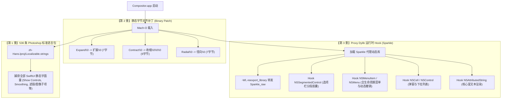

# Compositor 汉化工程全景交接指南 (Agent Handover Guide)

> **致接手本项目的 AI Agent 伙伴**：  
> 本文档旨在让你在 **3 分钟内** 以最低 Token 消耗、最精确的上下文，掌握本项目的所有历史沉淀、底层架构决策、深水区踩坑总结以及未来版本迭代的维护 SOP。

---

## 一、 项目背景与核心诉求

* **原项目**：[Compositor](https://github.com/robbietilton/Compositor)（由 Robbie Tilton 开发），基于纯原生 Swift (SwiftUI / AppKit) + Metal 硬件加速构建的 macOS 图像合成编辑器，体积仅 **~12MB**（相比 Photoshop 6.4GB 缩减 99.8%）。
* **用户诉求**：
  1. **极度彻底汉化**：界面、菜单、滤镜、图层、选项栏、弹窗等 100% 汉化，不能有任何顽固英文遗漏。
  2. **专业术语标准**：严格对照 **Adobe Photoshop 官方简体中文版** 行业术语习惯。
  3. **插件化（Plugin）零侵入**：不破坏原项目主干代码，确保上游升级版本覆盖后，能够瞬间秒级重新生效。
  4. **小白用户一键交付**：不懂计算机的用户无需打开终端，双击即可无感打补丁。

---

## 二、 踩坑全景图与底层技术攻防 (Hard Lessons & Pitfalls)

在对纯 SwiftUI + AppKit 混合架构的现代化 macOS App 进行无侵入汉化时，存在以下四大深水区巨坑：

### 坑点 1：macOS SIP 机制静默阻断环境变量注入
* **现象**：通过编写独立启动器 `launcher` 设置 `DYLD_INSERT_LIBRARIES` 试图动态注入 dylib，结果进程虽然运行，但 `vmmap` 检查发现 dylib **根本未被加载**。
* **原因**：现代 macOS（macOS 14/15/26）受到 SIP（系统完整性保护）及 Hardened Runtime 管控，在 GUI 进程派生与 `execv` 时，操作系统 dyld 会**物理强行剥除** `DYLD_INSERT_LIBRARIES` 环境变量。
* **破解方案**：**Proxy Dylib（代理动态库劫持挂载）**。Compositor 原生依赖自身 Bundle 内的 `Contents/Frameworks/Sparkle.framework/Versions/B/Sparkle`。我们将汉化插件编译为 `Sparkle`，并使用 `-Wl,-reexport_library` 100% 转发给原版 `Sparkle_raw`。系统 dyld 启动时将其视为合法必需依赖强行加载，彻底击穿 SIP 限制！

### 坑点 2：Swift 6 Small String 立即数内联优化
* **现象**：在二进制可执行文件的 `__cstring` 或全二进制中通过 grep / 二进制搜索 `Show Controls`、`Smoothing`、`Smear` 等词条，结果显示**出现 0 次**！
* **原因**：Swift 编译器对长度 $\le 15$ 字节的 ASCII 字符串实施了极端优化——直接作为 Tagged Pointer / Small String 立即数内联到汇编指令操作数中，根本不在 Mach-O 的静态常量段分配连续空间。
* **破解方案**：对于此类内联字符串，绝对不可指望静态修改二进制，必须依靠 `Localizable.strings` 词典与 SwiftUI `LocalizedStringKey` 的运行时关联机制进行捕获。

### 坑点 3：SwiftUI 强类型变量传参破坏静态本地化
* **现象**：选区工具栏的 `Expand` 与 `Contract`、图层菜单的 `Duplicate Layer` 与 `Merge Down`，即使在 `Localizable.strings` 中存在，依然显示英文！
* **原因**：
  * 源码中使用了形参传参：`modifyControl("Expand", ...)` 内部调用的是 `Button(title)`（`title: String` 为形参变量）；
  * 菜单中使用了三元运算符：`Button(session.selection == nil ? "Duplicate Layer" : "Layer via Copy")`。
  * **Swift 语言特性**：传给 `Button` / `Text` 的只要是 `String` 变量（而非编译期字面量），SwiftUI 内部会调用 `Button<S>(_ title: S) where S : StringProtocol`，**物理上直接绕过 `Localizable.strings` 查找**！
* **破解方案**：
  * 因为 `modifyControl("Expand", ...)` 里的 `"Expand"` 作为实参传入时是全局唯一的字符串常量，它在 Mach-O 的 `__cstring` 段中拥有独立的 7 字节空间（`Expand\0`）。
  * 我们实施 **1:1 等长静态字节覆盖**：
    * `Expand\0` (7字节) $\to$ `扩展\0` (7字节)
    * `Contract\0` (9字节) $\to$ `收缩\0\0\0` (9字节)
    * `Radial\0` (7字节) $\to$ `径向\0` (7字节)
    零长度偏移、零崩溃风险，彻底在最底层将变量直接定格为中文！

### 坑点 4：词条收录遗漏引发的“界面半汉化假象”
* **现象**：同一组控件中，前面的词是中文，末尾的词是英文（如“画笔、橡皮擦、大小、硬度”全中文，唯独末尾的 `Smoothing` 是英文；“自由变换、自动选择”是中文，旁边的 `Show Controls` 是英文）。
* **原因**：排查发现并非机制失效，而是早期词表只收录了 80 个高频词，未完整覆盖全部 500+ 个选项栏细项。补全 536 条全量词库后，SwiftUI 字面量直接大面积转为中文。

---

## 三、 当前生产级架构：三重防御复合引擎 (3-Tier Architecture)



---

## 四、 核心目录与代码资产清单

```text
/Users/hansonwang/Documents/PS-Compositor/
├── plugin/
│   ├── README.md                      # 插件设计与使用说明
│   └── CompositorZH/
│       ├── zh-Hans.lproj/
│       │   └── Localizable.strings    # 核心语言包 (536 条 Photoshop 标准行业词库)
│       ├── Sources/CompositorZH/
│       │   ├── CompositorZH.m         # 运行时 Hook 插件源码 (Objective-C Runtime)
│       │   └── launcher.c             # 备用启动器源码
│       ├── CompositorZH.dylib         # 预编译生成的动态库
│       └── Scripts/
│           ├── install_plugin.py      # Python 核心安装维护脚本 (双击/命令行两用)
│           ├── install.sh             # 终端一键安装脚本
│           └── build_installer.sh     # 小白一键安装包打包脚本
├── docs/
│   ├── compositor_research_report.md  # 初始技术调研报告
│   └── HANDOVER_GUIDE.md              # 【本文件】Agent 项目交接总纲
└── release/                           # 面向最终用户的一键分发物
    ├── 一键汉化补丁.command           # 双击即自动安装的终端批处理程序
    └── Compositor一键汉化补丁.app      # 双击运行的 macOS 原生独立弹窗补丁小程序
```

---

## 五、 未来 Agent 维护与升级 SOP

### 1. 原作者发布新版本 Compositor 后，如何恢复汉化？
原作者升级覆盖 `/Applications/Compositor.app` 后，其内部二进制和 Sparkle 库会被重置为官方纯英文版。  
**接手 Agent 只需在终端执行以下单行命令**：
```bash
python3 plugin/CompositorZH/Scripts/install_plugin.py --app /Applications/Compositor.app
```
脚本会自动：
1. 校验并重新注入 `zh-Hans.lproj` 资源；
2. 自动修补新二进制中的静态变量（Expand/Contract 等）；
3. 自动生成新版 Sparkle Proxy Dylib 并执行符号重导出；
4. 重新执行 Ad-hoc 代码签名，恢复 100% 汉化。

### 2. 用户发现新词条未翻译，如何新增词条？
1. 打开 `plugin/CompositorZH/zh-Hans.lproj/Localizable.strings`；
2. 按照 `"英文" = "Photoshop对应中文";` 格式添加；
3. 检查是否有带省略号形式（如需要同时添加 `"条目…"` 和 `"条目..."`）；
4. 运行语法检测：`plutil -lint plugin/CompositorZH/zh-Hans.lproj/Localizable.strings`；
5. 如果词条属于动态分段按钮或特殊菜单，在 `CompositorZH.m` 的 `specials` 字典中同步添加；
6. 重新运行 `install_plugin.py` 即可。

### 3. 如何一键卸载并恢复为官方出厂状态？
```bash
python3 plugin/CompositorZH/Scripts/install_plugin.py --uninstall
```
脚本会自动移除 `zh-Hans.lproj`、恢复原版 `Sparkle` 动态库，并完成重签，100% 还原官方原版状态。
