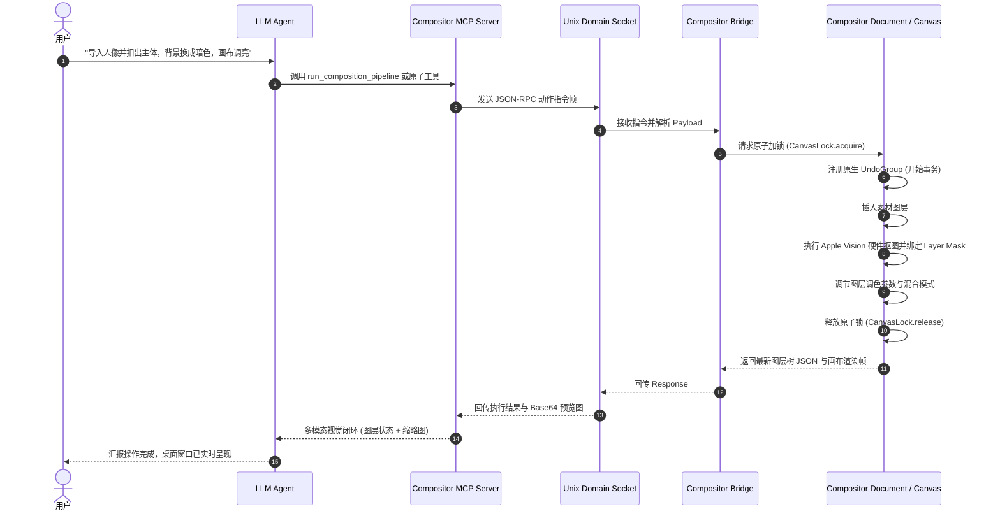

# 系统架构设计：自然语言 Agent 驱动 Compositor (system_design-REQ-001)

**Status: Approved**  
**Resolves: REQ-001**

---

## 1. 系统整体架构

整个系统由三大模块构成：**LLM 对话端 (Agent)**、**Compositor MCP Server (Python)**、以及 **Compositor 原生应用宿主 (Swift + Metal)**。

```mermaid
flowchart TD
    User([用户 自然语言输入]) <--> Agent[Antigravity / LLM Agent]
    
    subgraph AgentHost["Agent 运行环境"]
        Agent <-->|MCP 协议 / stdio| MCPServer[Compositor MCP Server\n(Python FastMCP)]
    end
    
    subgraph IPC["本地进程间通信 (IPC)"]
        MCPServer <-->|Unix Domain Socket\n(/tmp/compositor_agent.sock)| Bridge[CompositorAgentBridge\n(Swift 源码级模块)]
    end
    
    subgraph NativeApp["Compositor.app (Swift + Metal)"]
        Bridge --> CanvasLock[画布原子锁 CanvasLock]
        CanvasLock --> DocMgr[Document & Layer Tree 管理器]
        DocMgr --> UndoMgr[原生 UndoManager (Cmd+Z)]
        DocMgr --> MetalPipeline[Metal GPU 实时渲染管线]
        DocMgr --> VisionKit[Apple Vision 硬件抠图引擎\n(VNGenerateForegroundInstanceMask)]
        MetalPipeline --> LiveWindow[macOS 桌面实时视窗]
    end
```

---

## 2. 模块时序交互流程



---

## 3. 核心设计契约与关键规范

### 3.1 坐标系设计
- **Top-Left (左上角原点，Y 轴向下)**：
  - 画布尺寸统一为物理像素，坐标 $(x, y)$ 为矩形左上角，对齐 Photoshop 与现代设计规范。
  - 底层若涉及 AppKit / Metal 视口倒置，由 `CompositorAgentBridge` 内部统一矩阵翻转处理。

### 3.2 调色与滤镜参数映射
- **双轨制契约**：
  - 物理数值：`exposure` [-5.0, 5.0]、`contrast` [-100, 100]、`saturation` [-100, 100]、`opacity` [0, 100]、`blur` [0, 100]。
  - 语义枚举：支持 `"slight"`, `"medium"`, `"strong"` 快捷映射，防止数值越界。

### 3.3 并发加锁与 Undo 事务
- **严格原子加锁**：Agent 发起指令时，临时挂起 GUI 交互输入；执行完毕释放，确保主线程安全与状态一致。
- **系统级 Undo**：每次动作打包为一个 `NSUndoManager` 分组，用户可在 Compositor 界面直接敲击 `Cmd+Z` 物理回滚。

### 3.4 汉化与源码维护边界
- **解耦维护**：Compositor 官方开源源码保持原生实现，汉化资源由现有的 `CompositorZH` 插件体系独立挂载，互不干扰。
